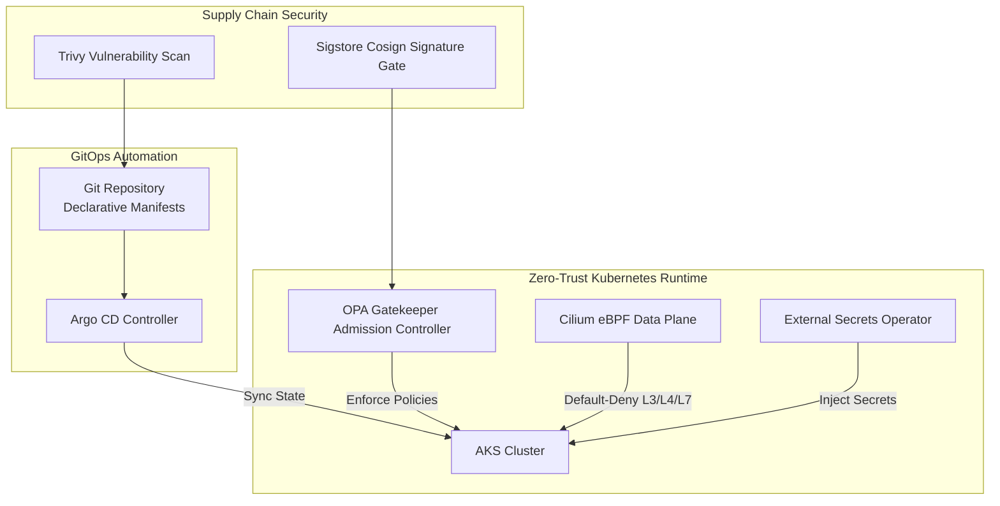

# ☸️ Zero-Trust Kubernetes GitOps

Hardened Multi-Tenant Kubernetes (AKS) cluster architecture driven strictly by **ArgoCD GitOps pipelines**, **Cilium eBPF network security**, **HashiCorp Vault** secret injection, and **Open Policy Agent (OPA) Gatekeeper**.

---

## 🛡️ Architecture & Security Mesh

---

## ⚡ Key Engineering Patterns

* **Cilium eBPF Network Security ([`cilium-policies/`](./cilium-policies)):** Default-deny network security policies with DNS-aware egress whitelisting.
* **OPA Gatekeeper ([`gatekeeper/`](./gatekeeper)):** Restricts root containers, requires read-only root filesystems, and enforces image digest verification.
* **Vault Integration ([`vault-external-secrets/`](./vault-external-secrets)):** External Secrets Operator syncs ephemeral dynamic credentials into Kubernetes Secrets.
* **Terraform Modular Engine ([`terraform/`](./terraform/)):**
  * `for_each`: Multi-tenant secondary node pools with dedicated taints and labels.
  * `dynamic "upgrade_settings"`: Enforces zero-downtime rolling upgrades with custom surge capacity.
  * Conditional iteration: Key Vault CSI rotation and Azure CNI with Cilium data plane.

---

## 👤 Author

**Rishikesh Sharma**  
Senior DevSecOps Engineer & Cloud Solutions Architect  
[GitHub Profile](https://github.com/RisikeshSharma) · [LinkedIn](https://linkedin.com)
